# Latent Action Pretraining From Video

主要为了解决当前VLA使用的带action label数据的规模不够的问题。因此提出，可以从不带动作标签的视频中学习隐动作先验，使得只要经过少量微调就可以在跨本体，跨环境等通用场景下表现出更好性能。文章甚至研究了使用纯人类操作视频来进行预训练，也表现除了不错的性能，但是这些视频仍然需要带指令标签，目前还无法拓展到任意的这种操作视频。

# Training

训练阶段：

1. 隐动作预训练
    - 隐动作量化模型
    - VLM
2. 微调

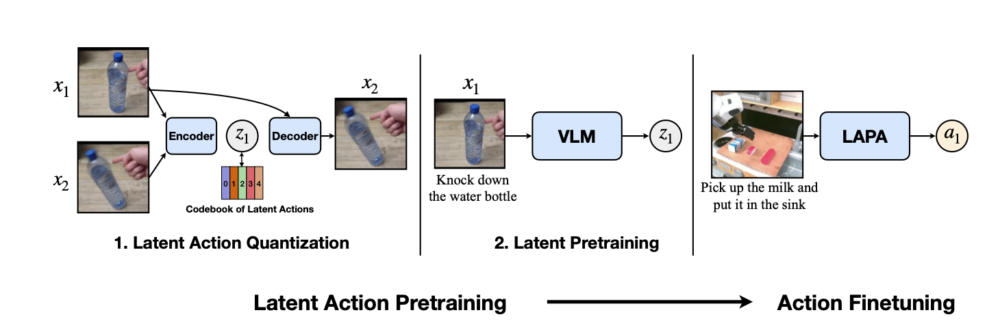

## 量化模型

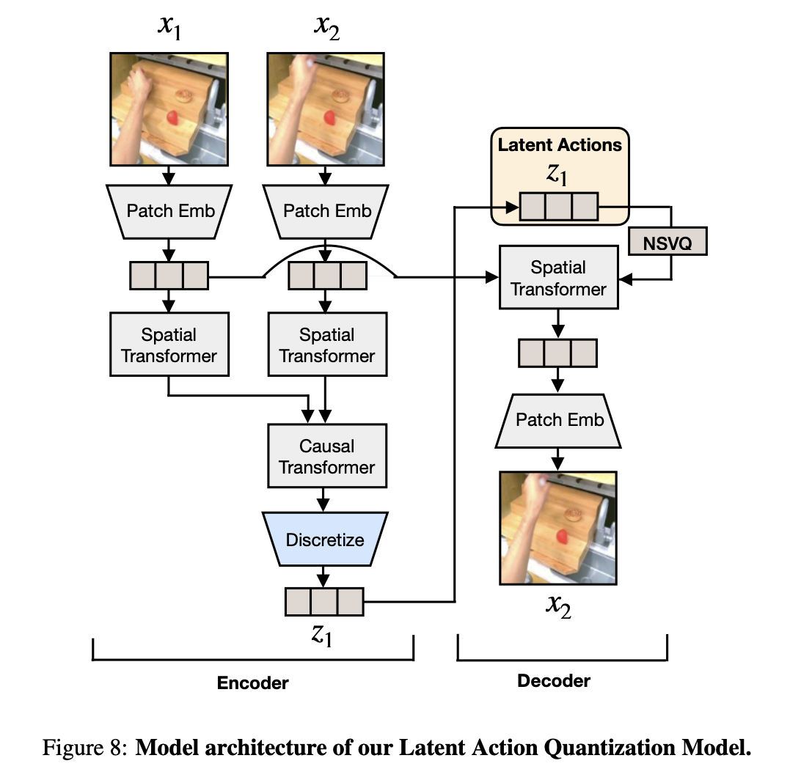

1. **NSVQ**: 将encoder输出映射为码本中隐动作时使用的 `argmin` 转化为可微分函数，确保梯度可以回传

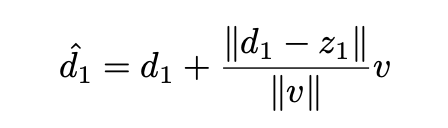

2. **stop gradient**: 防止梯度不经过 `encoder` 直接传回 `patch embedding`, 造成表示坍塌

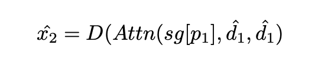

3. **码本替换**: 提升码本利用率

## VLM

**组成**：

1. VLM
2. 隐动作头(将VLM输出映射到硬动作空间,输出码字的概率分布)

**阶段**:

1. 由量化模型中的encoder为无标签视频相邻帧之间打上隐动作标签
2. 使用该数据训练VLM(冻结visual encoder)

## 微调

随后在带真实动作标签的数据上进行微调
1. 舍弃原有的隐动作头，训练一个新的动作头
1. 对机器人动作每个维度进行等频分桶

# 实验

提出三个问题：

1. RQ1: 模型在跨任务，跨环境，跨本体场景下的表现
2. RQ2: 使用无动作标签的多本体数据能否得到更好的先验
3. RQ3: 能不能只从人类操作视频中学习

**环境**：

1. Language Table
2. SIMPLER
3. Real World

**Baseline**

- Scratch
- UniPi
- VPT
- ActionVLA
- OpenVLA

## 实验一：Language Table

考察模型在跨任务，跨环境场景下的表现，共设置了五个任务

**根据数据类型分为三组**：
- in-domain:
- cross-task: 
- cross-environment:

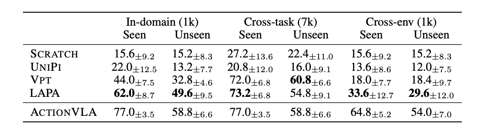

## 实验二：真实世界

**实验目的**

- 跨本体
- 在多本体场景下

**数据**：

1. 预训练: 
    - BridgeV2
    - OXE
2. 微调: Franka

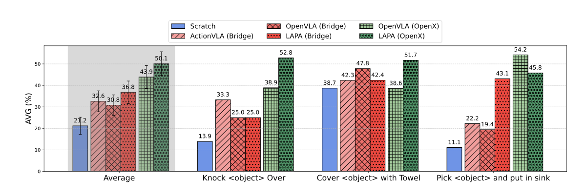

## 实验三

验证能否只通过人类操作视频训练LAPA

**数据**：预训练用 `Something-Something V2` 人类操作视频；

- SIMPLER: baseline预训练使用同样人类视频，SIMPLER数据微调
- 真实环境: baseline预训练使用bridge，全部使用真机franka数据微调(这里也涉及跨本体情况)

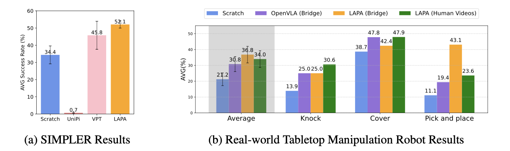

# 消融实验

考察LAPA的性能是否也和规模相关。全部运行在SIMPLER环境(`C`运行在 `language table`)

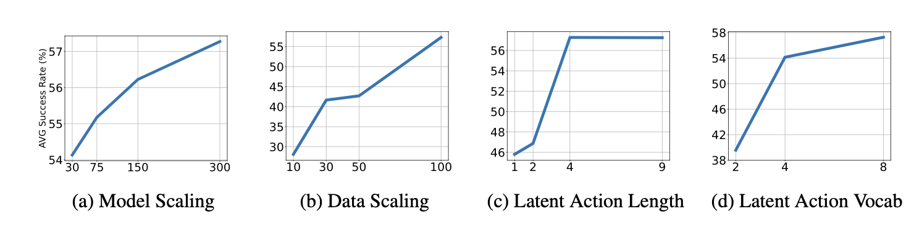

# 隐动作分析

考察LAPA生成的隐动作和decoder重建的图像,分别在OXE和人类操作视频预训练情况下测试

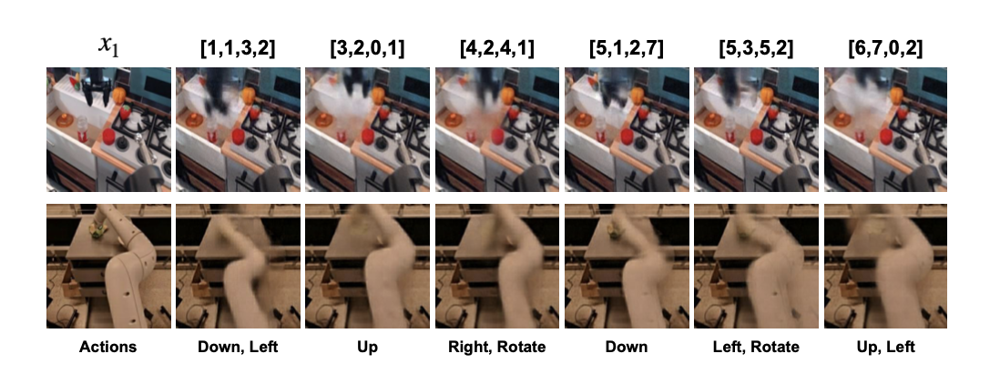

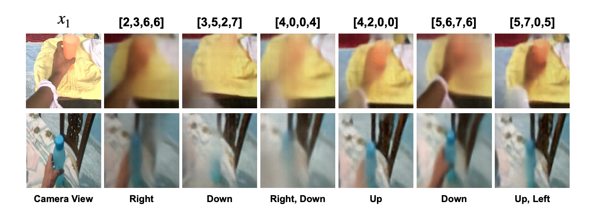

证明隐动作空间在不同本体和环境的情况下都是通用的。在预训练阶段来学习隐动作表示使得模型有更好通用性。

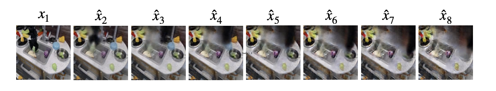

在不经微调的LAPA上运行close-loop rollout。可以看到不靠任何真值动作的微调，并且不依赖模拟器，仅靠LAPA就可以模拟机器实际执行的轨迹。这表明了LAPA可以作为通用机器世界模型。**Task and Motion Panning System**

# Limitation

1. **精细动作弱**
2. **场景覆盖有限**

# 后续工作

1. DreamGen：视频模型根据机器特点生成训练视频，作为LAPA训练数据。
2. UniVLA：将隐动作分为任务相关/无关，分别训练，并将任务相关隐动作作为最终动作标签
3. CLAM：不使用VQ，使用连续隐动作
4. LaWAM：将decoder用于VLM推理过程中。