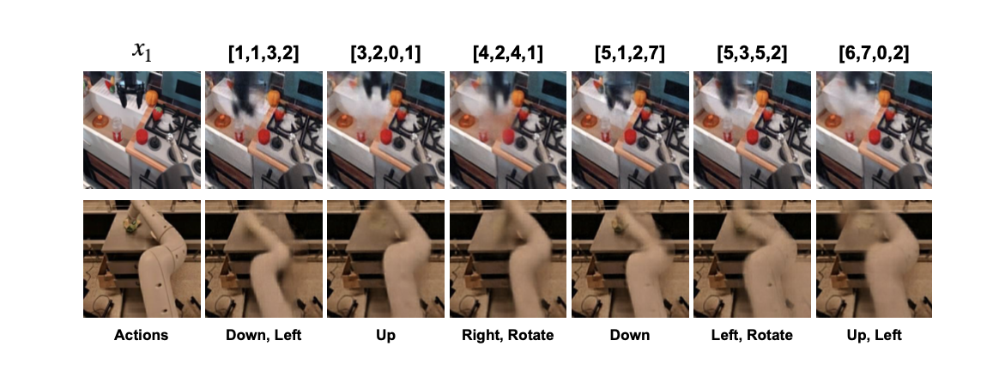

1. VLA和VLM的区别，他们分别的架构
1. transformer的具体工作方式
1. 超参数是什么

主要为了解决当前VLA使用的带action label数据的规模不够的问题。因此提出，可以从不带动作标签的视频中学习隐动作先验，使得只要经过少量微调就可以在跨本体，跨环境等通用场景下表现出更好性能。文章甚至研究了使用纯人类操作视频来进行预训练，也表现除了不错的性能，但是这些视频仍然需要带指令标签，目前还无法拓展到任意的这种操作视频。

**两个挑战**：
- 视频没有动作标签
- 和具体的环境和本体有差别

隐动作预训练包含两个阶段：
    - 量化模型：使用VQ-VAE目标训练
    - VLM：BC
随后是一个微调阶段。整体结构图：

## 量化模型

首先是量化模型部分，包含一个encoder和一个decoder，架构如下：

相邻两帧经过...后相减得到一个d，表示两帧之间的差异，也就表示造成这种差异的隐动作。随后需要对d做一个discretize，也就是需要将这个连续值映射到一个离散的隐动作空间。首先他会通过一个CNN，来得到一个长度为s的向量序列。然后他还有一个codebook，一个码本，大小为C。这就相当于一个C的S次方大小的隐动作空间。然后他就将每个向量对应为离他最近的码本中的一个token。他的输出就是类似...这样的四元祖。随后将结果交给decoder，连同最开始生成的x1的patch embedding输入一个cross attention，x1作为query，然后隐动作作为keyvalue，来推理得到下一帧的表示，并和实际表示计算损失。

那么这里为了梯度能够正确的反向传播以及防止表示坍塌，他使用了三个技术：

1. 首先是这里的NSVQ。这个就是因为encoder的输出是codebook中索引的硬编码，要是直接输入码本中的token这个肯定是没法计算梯度的。所以就要使用NSVQ。就是将卷机后得到的向量d加上一个噪声，这个噪声大小为d和码本中向量的距离，方向随机的向量。

这样梯度就可以传回去了。

2. stop gradient: 给x1的patch embedding加上了sg。也就是梯度不会顺着这条路径传回去，来防止representation collapse，也就是表示坍塌。sg的主要作用实际上是让patch embedding更好的表示图像使得两帧之间的差分更有用，而不是构造出一个让decoer更好重建下一帧图像的表示。比如说，如果没有sg，那么编码器更倾向于给出更加底层的图像表示，这个表示可能包含了每个图像的大量细节，这时候编码器只要把这个表示拿过来稍作修改，他的重建损失就不会很高，对隐动作的考虑就会变少。而正常情况下patch embedding需要给出一个更抽象的表示，就只包含物体的移动，这样才能让计算出的隐动作象征物体变化。如果没有sg，那么decoder学到的就是这个图像和常见情况差在哪，而不是这个图像在某个隐动作下会发生什么样的变化。

3. 码本替换：就是在训练初期会替换掉码本中没怎么被引用的项

这里论文还说到一点，就是这个量化模型中的encoder相当于一个IDM，decoder相当于一个世界模型。那么这个量化模型就可以在不借助任何模拟平台的情况下进行闭环测试，也就是...。

## VLM

微调的第二阶段是用BC训练一个VLM。首先需要量化模型中的encoder来为视频数据打标签。随后VLM根据当前帧和提示词推理动作，这个动作的向量表示输入一个隐动作头中，生成码字的概率分布，根据这个概率分布选择出最终的隐动作。

## 微调

随后在带真实动作标签的数据上进行微调，主要关注这两点
1. 舍弃原有的隐动作头，训练一个新的动作头
1. 对机器人动作每个维度进行等频分桶。将动作从连续表示转化为离散表示，也就是将回归标签转化为分类标签。

## 实验

提出三个问题：
RQ1: 模型在跨任务，跨环境，跨本体场景下的表现
RQ2: 使用无动作标签的多本体数据能否得到更好的先验
RQ3: 能不嫩只从人类操作视频中学习

**三个环境**：
1. Language Table
2. SIMPLER
3. real world

**五个基线**，简单介绍一下各自代表什么：

- **Scratch**：不预训练，直接微调。这是「预训练到底有没有用」的对照。
- **UniPi**：用视频扩散模型按指令生成「计划视频」，再用反动力学模型提动作。也不用动作标签。
- **VPT**：用少量有标签数据训一个反动力学模型，再用它给海量视频打伪标签。也不用动作标签。
- **ActionVLA**：用**真值动作**预训练，和 LAPA 共用同一个 7B 主干。这是理论上界。
- **OpenVLA**：当时的 SOTA，在 970k 条真机示教上预训练的 7B 模型。

## 实验一：Language Table

考察模型在跨任务，跨环境，跨本体场景下的表现，共设置了五个任务

**根据数据类型分为三组**：
- in-domain:
- cross-task: 
- cross-environment:
分别在模型见过和没见过的场景下进行测试，结果如下：

**怎么讲这张表**：

第一，同域和跨任务这两组，LAPA 明显超过 Scratch，而且逼近用真值动作预训练的 ActionVLA。它用的是 1k 微调数据，只占预训练数据的 0.5%。

第二，**最值得看的是跨环境那两行**。这里预训练在真机、微调在仿真，中间隔着 real2sim 的鸿沟。VPT 几乎没有任何正迁移——18.0，比 Scratch 的 15.6 只高一点点，说明它那个反动力学模型对环境漂移非常敏感。而 LAPA 还有 33.6，是 VPT 的两倍左右。这是全文第一次显示出「学隐动作比学伪动作标签更稳」。

## 实验二

**实验目的**
- 跨本体:
- 在多本体场景下: 不用动作标签的预训练，能不能比用真值动作的预训练学到更好的先验?

**平台和任务**：真实的一台 Franka Panda，七个自由度，三个任务加起来 450 条微调数据。bridge数据集是由一台widowX通过遥操作采集的数据。OXE包含了多种本体多种任务的数据。

从实验结果可以得出:
1. 跨本体
2. 多本体
学习隐动作可以得到更好的物理先验，从而在微调后表现出更好的性能。有两点需要注意：
1. pick任务下：...使用真值动作标签的模型过拟合到了widowX的动作空间。
1. pick任务下：...作者给出的解释是抓取在轨迹中发生次数过少，所以这些微调数据不够。我觉得本质是因为隐动作更善于表示粗粒度的动作而不是抓取这种精细的动作，就使得LAPA的抓取能力完全依靠微调而不是预训练。

## 实验三

**数据**：预训练用 Something-Something V2, 人类视频；分别在模拟和真机环境下进行测试.SIMPLER上，baseline也使用同样的人类操作视频预训练。真机环境下，baseline使用bridge数据预训练，全部使用真机franka数据微调(这里也涉及跨本体情况)

## 实验四

论文还比较了LAPA的预训练效率，他的训练时间和收敛速度都显著优于baseline。作者认为这种效率的提升源自对LWM的使用，还有隐动作空间更小，因此学习映射更加容易

**作者给的两个原因**：第一，主干 LWM 的预训练目标本来就包括「生成下一帧」，它已经隐式理解了什么叫做「高层动作」；第二，LAPA 的动作空间小得多——论文里写的是 8⁴ 对 256⁷，也就是四个隐动作 token、每个 8 选 1，而 OpenVLA 是七维各 256 个桶。动作空间小，学习「从感知到动作」的映射自然更容易。

| 实验 | 预训练数据 | 微调数据 |
|---|---|---|
| Language Table 同域 | 仿真 181k 条轨迹 | 仿真 1k |
| Language Table 跨任务 | 仿真 181k | 只用一个子任务，7k |
| Language Table 跨环境 | **真机 442k** | 仿真 1k |
| 真机（跨本体） | BridgeV2 60k | 真机 450 条 |
| 真机（多本体） | Open-X 970k | 真机 450 条 |
| 真机（人类视频） | Sthv2 200k | 真机 450 条 |
| SIMPLER | BridgeV2 真机 60k | 仿真 100 条 |
| SIMPLER（人类视频） | Something-Something V2，200k 段人类视频 | 仿真 100 条 |

## 消融一：规模（正文 5.1）

考察LAPA的性能是否也和规模相关。因此考察LAPA在不同..下的性能。全部用 BridgeV2 预训练、SIMPLER 微调.

**结论**：四个维度都随规模上升。对于隐动作空间大小，隐动作空间大小和真值动作的复杂度有关。

## 隐动作分析

考察量化模型encoder生成的硬动作和decoder重建的图像。在OXE和人类操作模型结果

证明隐动作空间在不同本地和环境的情况下都是通用的。在预训练阶段来学习隐动作表示使得模型有更好通用性。

在不经微调的LAPA上运行闭环测试。可以看到不靠任何真值动作的微调，并且不依赖模拟器，仅靠LAPA就可以模拟机器实际执行的轨迹。这表明了LAPA可以作为通用机器世界模型。基于这种特性，作者在这里说...

## Limitation

1. **精细动作弱**，特别是抓取，失败集中在早期闭合夹爪，作者认为扩大隐动作生成空间可能有帮助，但论文没有验证。
2. **场景覆盖有限**，目前只在操作类视频上验证，相机运动虽然被隐动作捕捉到了，但自动驾驶、导航这些还没试。